# A7 – [Topic]

## Objective

Purpose of this assignment is to analyze bracket of A6 through the use of SolidWorks Simulation under loading. In this analysis I have done stress, deformation and a factor of safety calculations and modified this bracket accordingly

## Analyze

I used 6061 Aluminum Alloy with a 600 lbf downward force applied to the circular section. The upper mounting section was fixed in place.

Fixed geometry

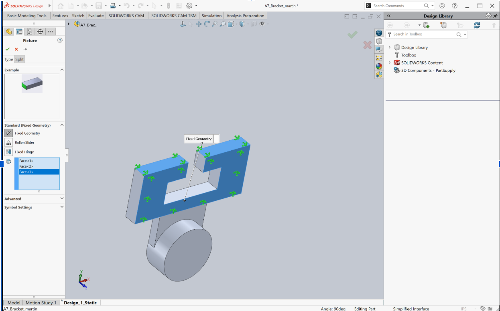

Applied Force

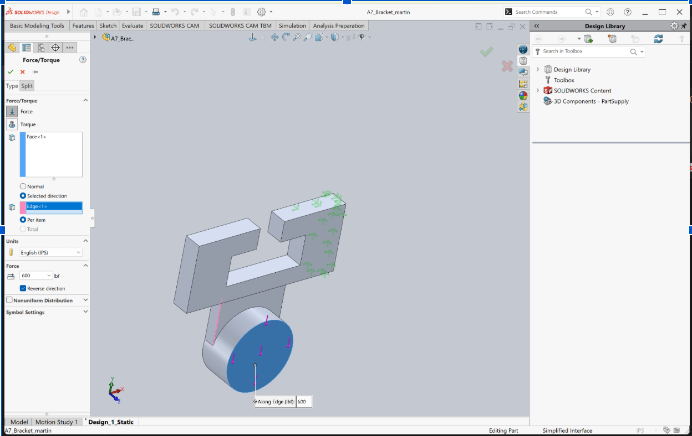

Design 1 - Original Bracket 

I created a static simulation and generated a mesh to analyze the original bracket. The highest stress occurred around the narrow connecting section.

Initial Mesh 

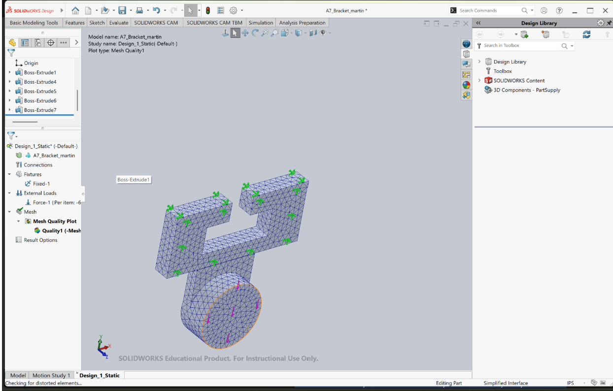

Stress Analysis

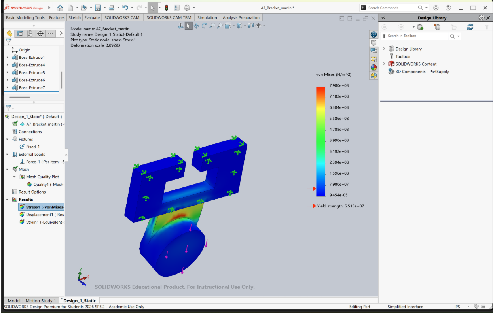

Mesh Details

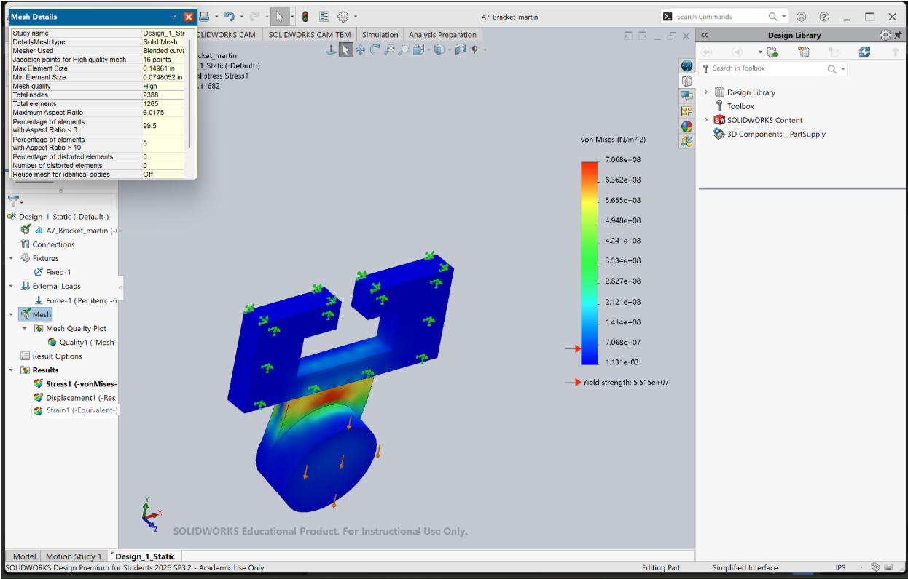

Design 2 - First Modification

I added a fillet near the lower circular connection to reduce the stress concentration

Modified Bracket

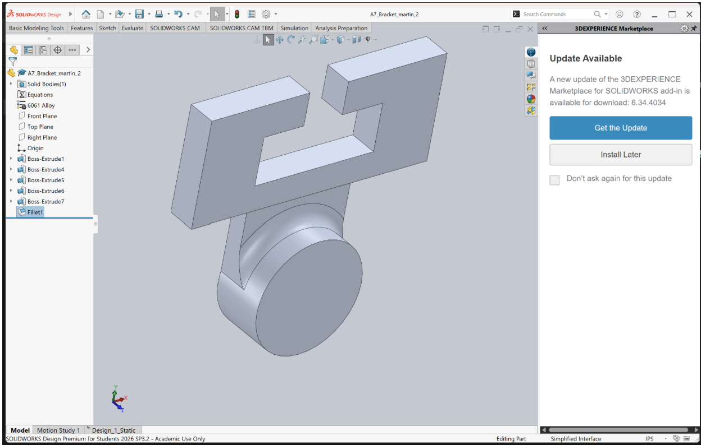

Stress Analysis

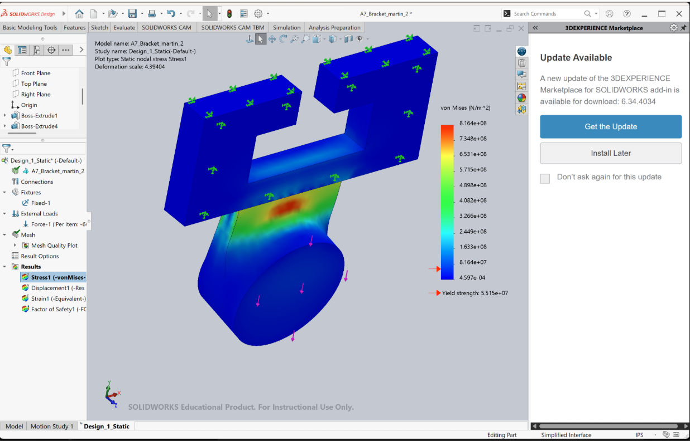

Design 3 - Second Modification

I added another fillet near the upper connection to create a smoother transition and improve the bracket's stress distribution

Final Bracket Geometry

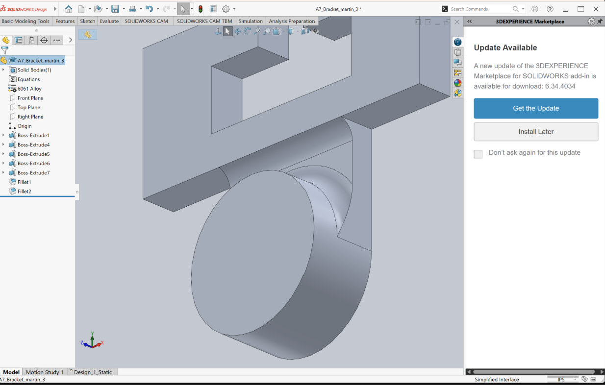

Stress Analysis

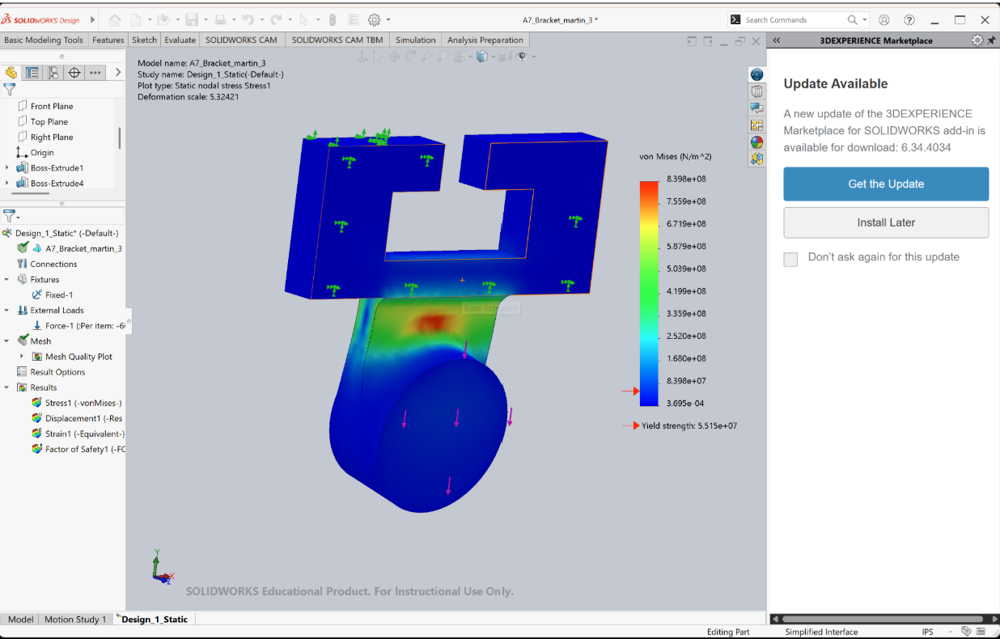

Displacement Analysis

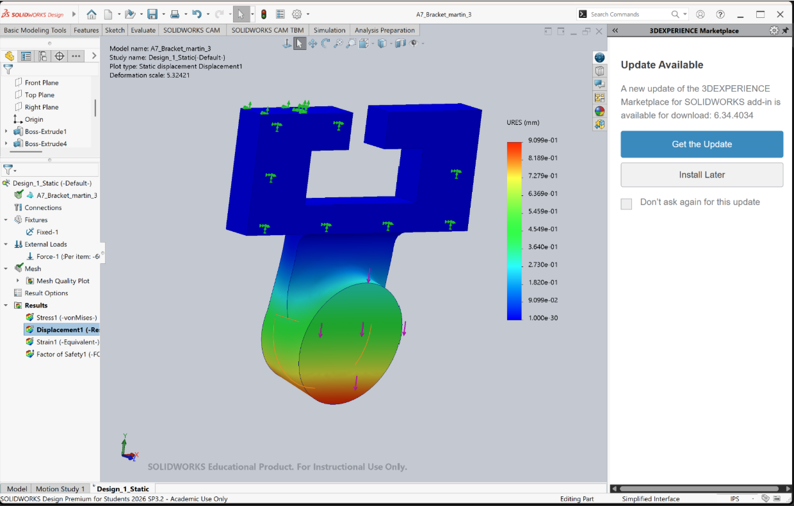

Factor of Safety

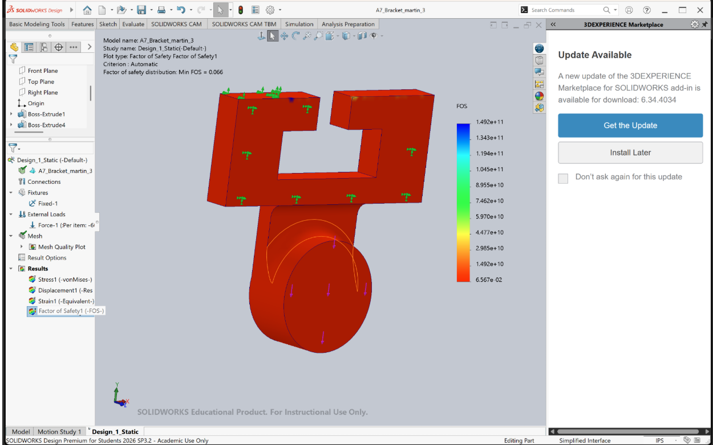

## Decide

## Communicate

