# A8 – Gearbox Design

## Project Overview
Part 1 - Shaft Design

Calculated the shaft stresses and evaluated the input and output shaft diameters.

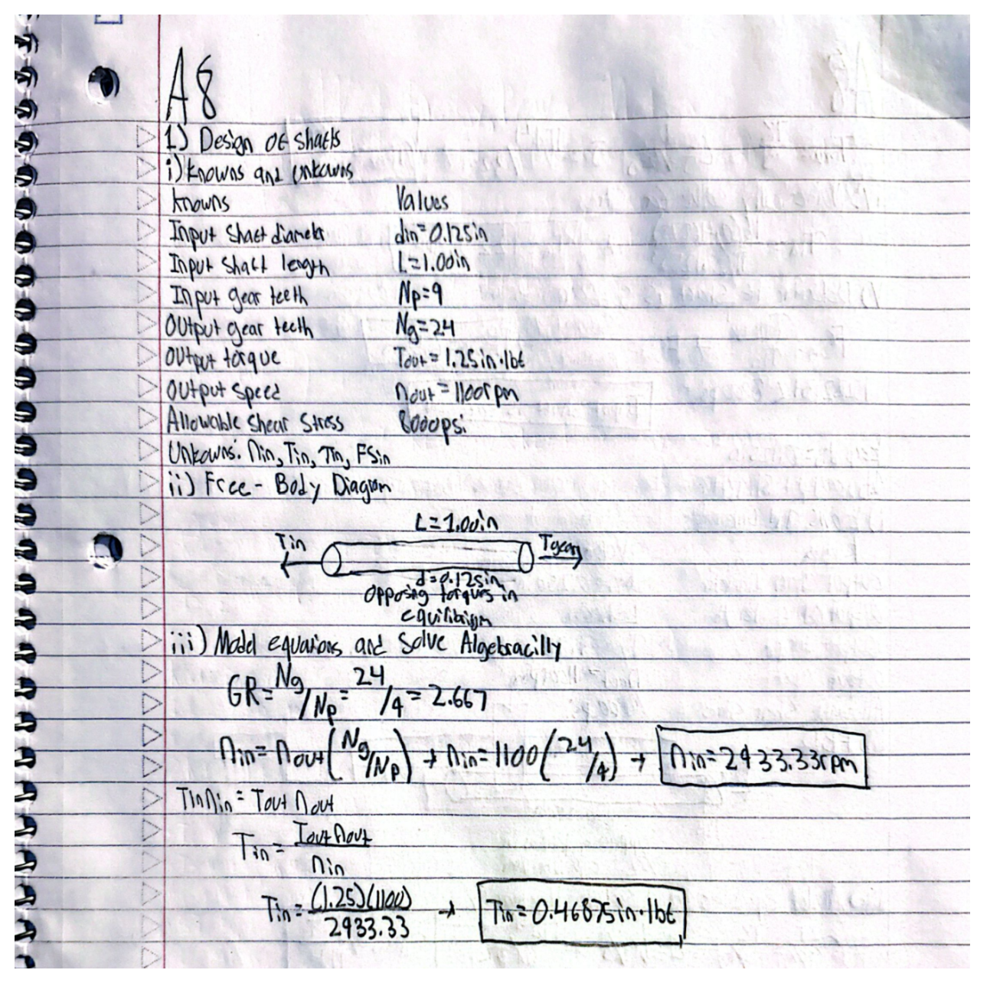

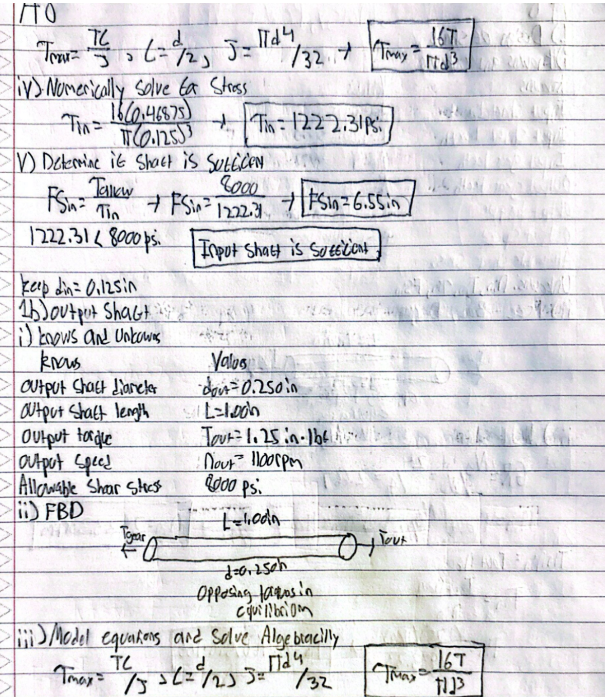

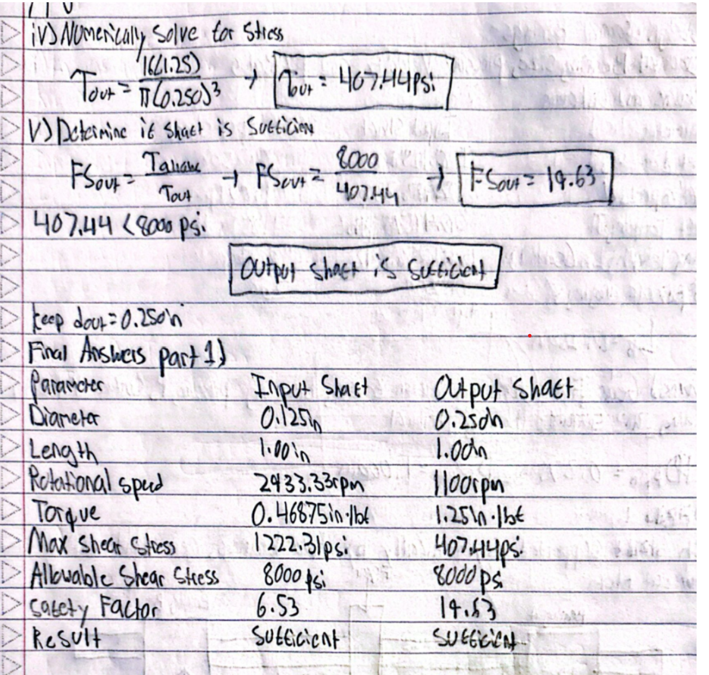

Part 2 - Journal Bearing Design

Selected journal bearings based on pressure, velocity, and PV limits. Calculated preliminary bearing wall thickness and selected components from McMaster-Carr.

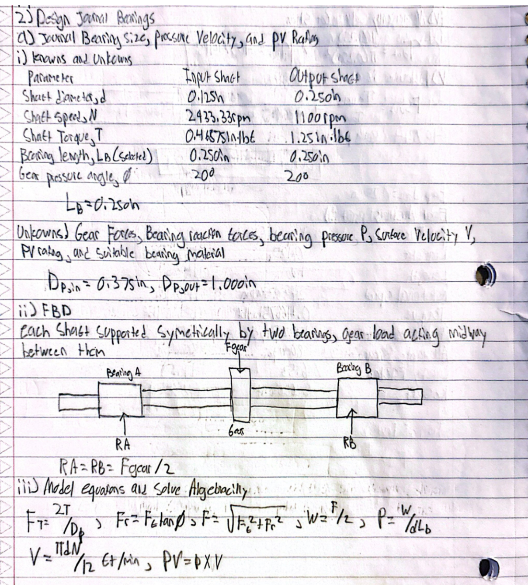

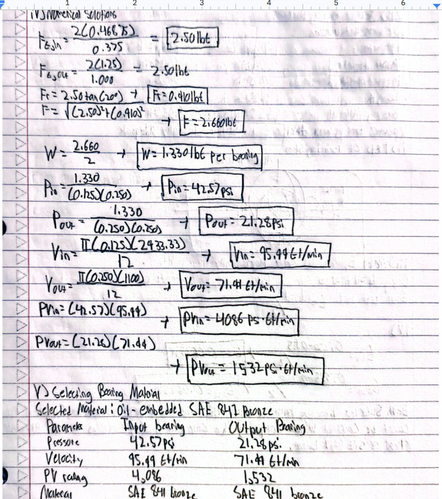

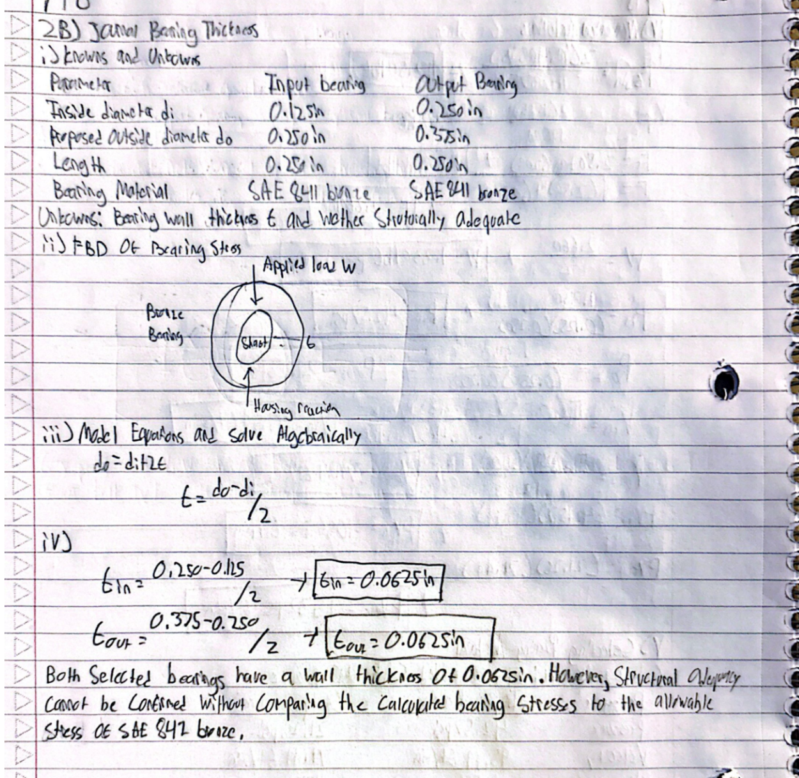

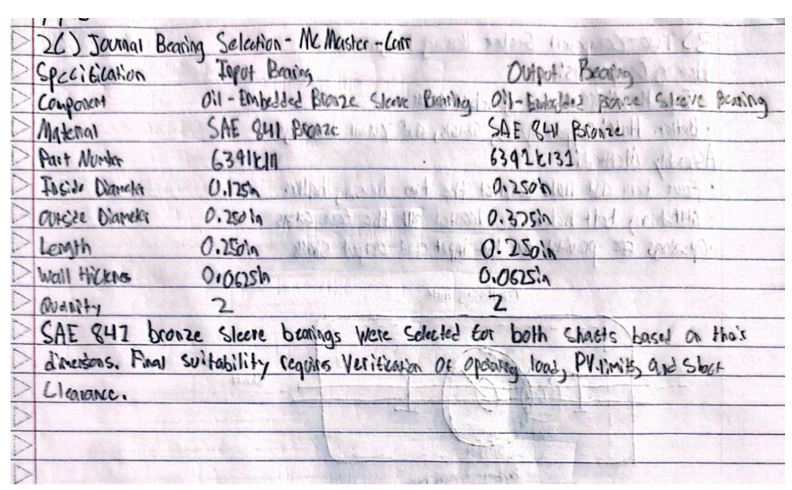

Part 3 - Gearbox Housing Design

Developed a two-piece gearbox housing concept with a removable top cover and bolted assembly.

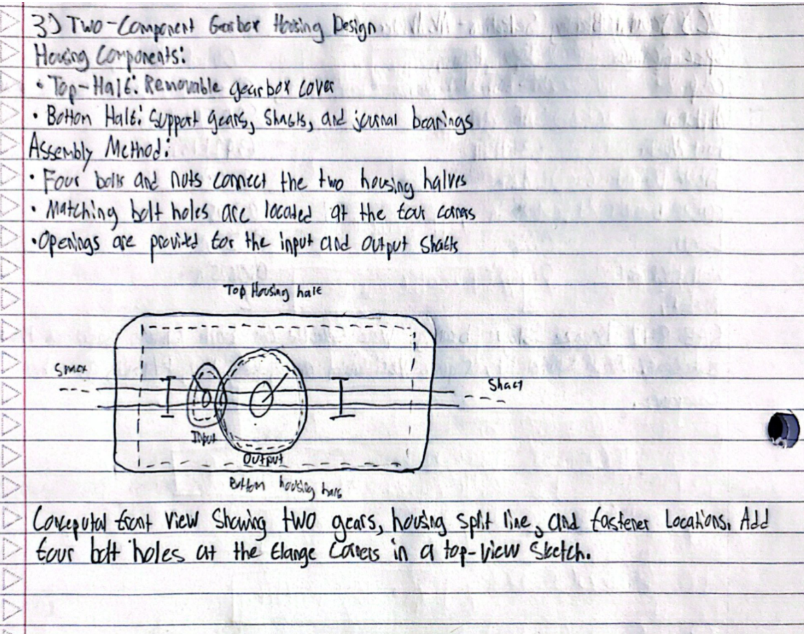

Part 4 - SolidWorks CAD

Created a gearbox assembly in SolidWorks consisting of:

• Input and output shafts 

• Small input gear and large output gear

• Bottom gearbox housing

• Top gearbox housing

The two housing halves were modeled separately with shaft openings and internal cavities to accommodate the gears.

The gears and shafts were positioned inside the bottom housing. Both housings halves were created, although final housing alignment and clearance adjustments were not completed.

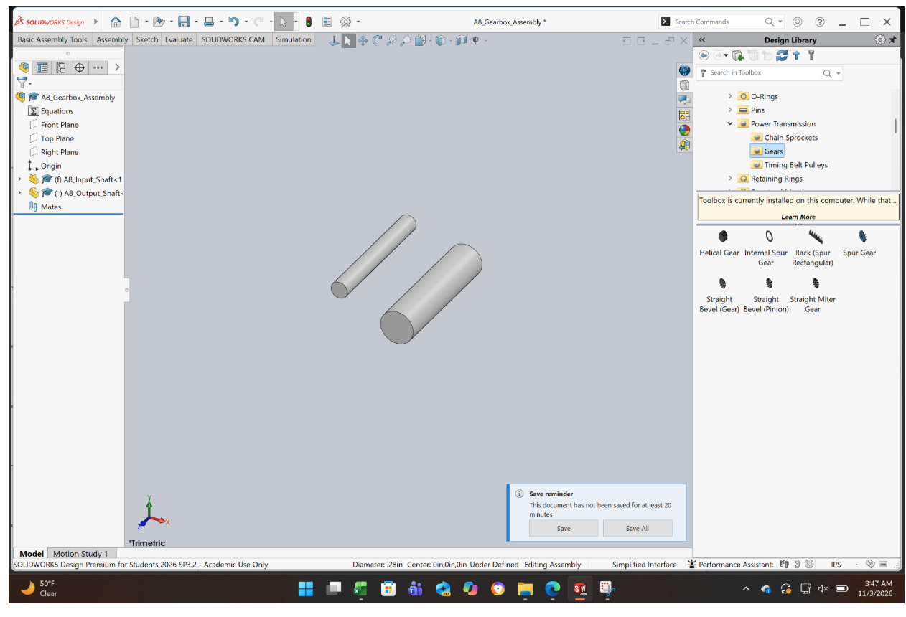

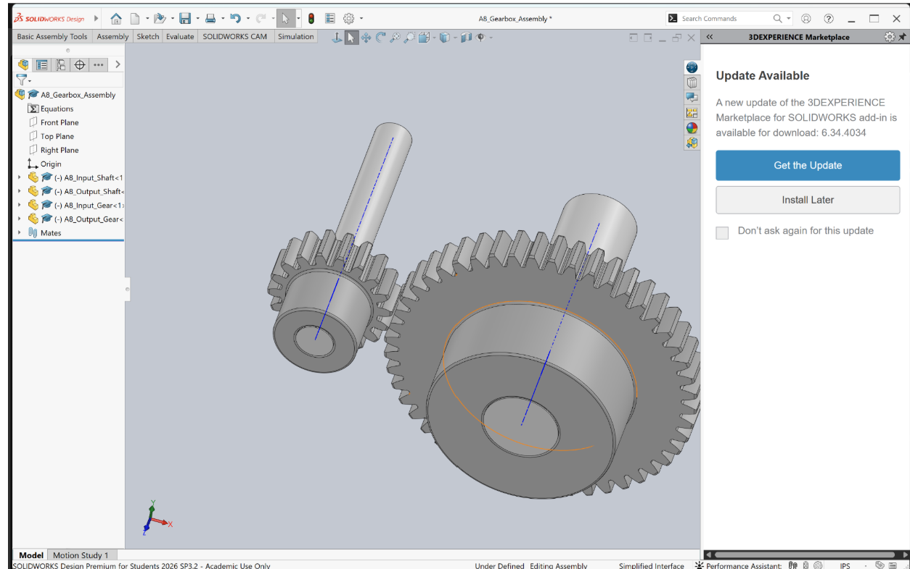

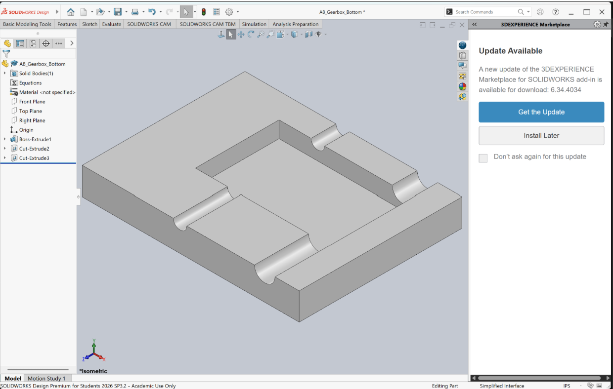

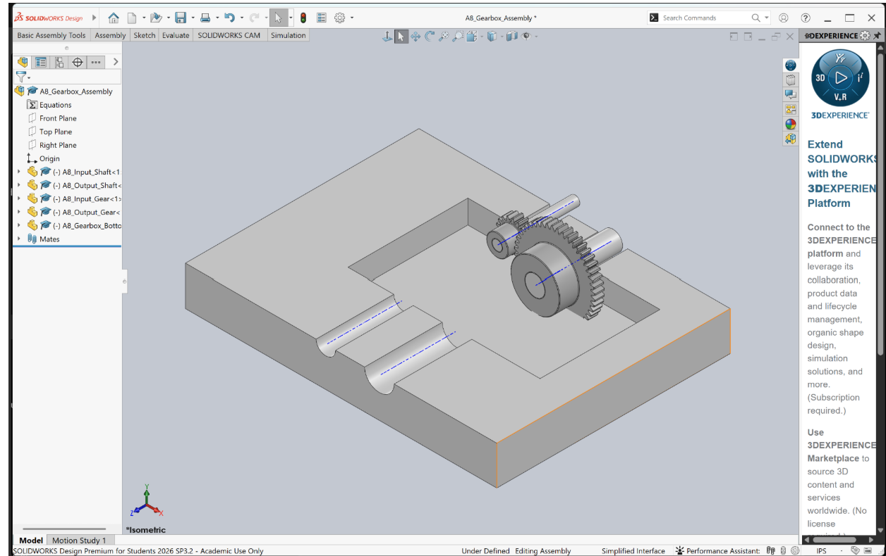

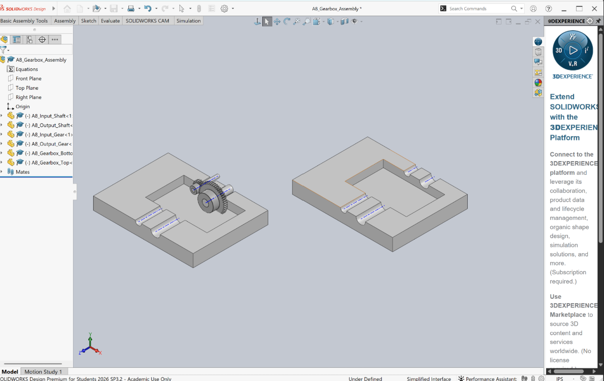

Part 5 - Lessons Learned

Throughout this assignment, I learned

• How to calculate shaft stresses and determine if a shaft diameter is sufficient

• How to evaluate journal bearings using pressure, velocity, and PV ratings

• How to select appropriate bearings from McMaster-Carr

• How bearing dimensions affect gearbox design

• How to develop a two-piece gearbox housing concept

• How to create shafts and begin an assembly in SolidWorks

• The importance of checking component compatibility before completing a CAD assembly

• How to troubleshoot difficulties when importing CAD components

This assignment took me around 8 hours to complete

## CAD File

[Gearbox Assembly](A8_Gearbox_Assembly.SLDASM)
  
[Bottom Housing](A8_Gearbox_Bottom.SLDPRT)

[Top Housing](A8_Gearbox_Top.SLDPRT)

 [Input Gear](A8_Input_Gear.SLDPRT)

 [Output Gear](A8_Output_Gear.SLDPRT)

[Input Shaft](A8_Input_Shaft.SLDPRT)

[Output Shaft](A8_Output_Shaft.SLDPRT)

[Input Bearing](A8_Input_Bearing.SLDPRT)

[Output Bearing](A8_Output_Bearing.SLDPRT)

